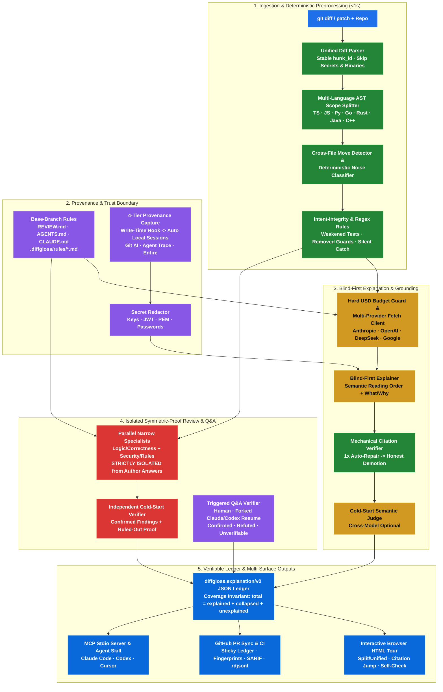
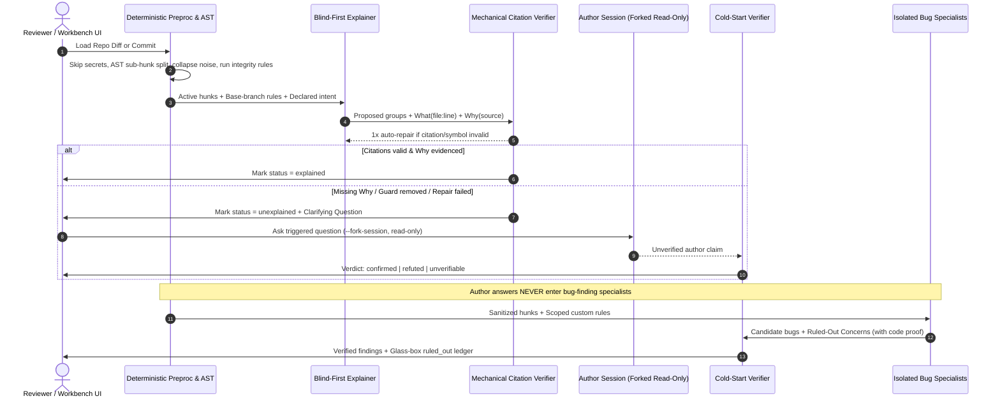
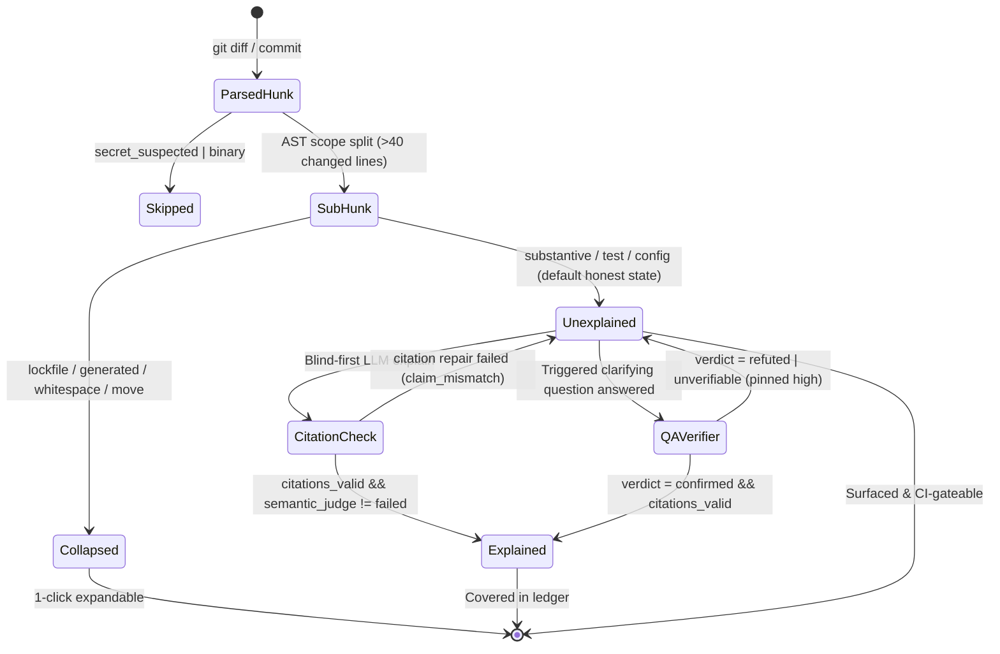

# Diffgloss

<p align="center">
  <strong>An explainability-first code review ledger for the AI coding era.</strong><br/>
  Turn any git diff into verifiable per-hunk coverage, evidence-backed explanations, symmetric-proof review, and an interactive offline browser tour.
</p>

<p align="center">
  <a href="https://atomsprout.com/diffgloss/"></a>
  
  
  
  
</p>

<p align="center">
  <strong><a href="https://atomsprout.com/diffgloss/">✦ Explore the Interactive 3D Site &amp; Live Demo ↗</a></strong>
</p>

---

## Why Diffgloss?

AI coding agents made **writing** code cheap and **understanding** diffs the bottleneck. Existing AI reviewers focus on hunting bugs or dumping unverified prose summaries—neither tells you **which parts of a diff nobody can actually explain**.

Diffgloss treats review comprehension as a **verifiable ledger**. Every hunk (and AST-split sub-hunk) must satisfy an explicit coverage invariant:

| State | Meaning | Verification Guarantee |
|---|---|---|
| **`explained`** | Covered by a semantic group with factual `what` + provenance-tagged `why` | `file:line` citations & backticked symbols mechanically checked (`citations_valid`) + optional cold-start semantic judge (`semantic_grounding`) |
| **`collapsed`** | Lockfiles, generated assets, pure whitespace/comments, import reorders, pure renames & cross-file verbatim moves | Classified deterministically first; always one click away to inspect |
| **`unexplained`** | Lacks rationale, contradicts declared intent, weakens test assertions, removes safety guards, or fails citation checks | Surfaced prominently at the top of the reading order with verifiable clarifying questions |

---

## Architecture



### Blind-First Independence, Q&A & Symmetric-Proof Sequence



### Hunk Coverage & Provenance State Machine



> **Key rule:** Author answers from Q&A enter only the `Why` provenance column and are **never** fed to the bug-finding specialists, preventing author self-defense from anchoring defect detection.

---

## Interactive Browser UI

Run `--serve` or open any generated `.diffgloss/report.html` offline (zero external CDN requests):

- **Coverage Ledger Bar** with instant filtering (`All`, `Unexplained`, `Explained`, `Collapsed`), risk dropdown, and live search (`/`)
- **Unified & Side-by-Side (Split) Diff** toggle (`s` shortcut)
- **Keyboard Navigation**: `j` / `k` next & previous hunk, `u` mark group understood (persisted in `localStorage`)
- **Clickable `file:line` Citations** that scroll to and highlight exact diff lines
- **Self-Check Mode**: hides `What` on high-risk hunks until you click **Reveal What**, countering passive comprehension debt
- **Glass-Box Panels**: attached built-in/SARIF findings in hunk context, collapsible **Symmetric Proof (Ruled-Out Concerns)**, and **Structured Rule Telemetry**
- **Repo & Commit Workbench (`📂 Repo / Commit`)**: switch to any local git repository, browse recent & nearby repos, inspect Working Tree / Staged / Branch Ranges, or click any commit in git history to load its diff & commit message in <1s
- **In-Page Model Configuration (`⚙ Models`)**: 1-click presets for DeepSeek, Claude, OpenAI, Gemini, OpenRouter, Ollama, Qwen, Kimi, GLM & custom OpenAI-compatible endpoints, with live **Test Connection** and **▶ Run Explain Now** (saved locally to `~/.config/diffgloss/settings.json` with `chmod 600`, zero env vars needed)
- **Live Browser Q&A**: in `--serve` mode, submit answers directly in the browser to persist back to `.diffgloss/ledger.json`

---

## Quick Start

### Install & Build

```bash
git clone https://github.com/atomsprout/diffgloss.git
cd diffgloss
bun install
bun run build
```

### 1. Zero-Env-Var Browser UI (Configure Any Model In-Page!)

```bash
# Opens browser UI immediately — click "⚙ Models" to pick a preset (DeepSeek, Claude, OpenAI,
# Gemini, OpenRouter, Ollama, Qwen, Kimi, GLM, or Custom), save your key locally (~/.config/diffgloss/settings.json, chmod 600),
# test connection, and click "▶ Run Explain Now" right in the page!
node dist/cli.js ui main..HEAD
```

### 2. Fast Deterministic Inspection (<1s, zero LLM cost)

```bash
node dist/cli.js inspect HEAD~1..HEAD \
  --intent "Implement sliding session TTL" \
  --serve
```

### 2. Estimate Cost Before Spending (`--dry-run`)

```bash
node dist/cli.js explain main..HEAD \
  --provider deepseek \
  --intent "Implement sliding session TTL" \
  --dry-run
```

### 3. Full Blind-First Explain + Semantic Judge + Symmetric-Proof Review

```bash
# DeepSeek (verified ~$0.005 per multi-file PR!)
DEEPSEEK_API_KEY=... node dist/cli.js explain main..HEAD \
  --provider deepseek --model deepseek-chat \
  --judge --review \
  --intent "Implement sliding session TTL. Do NOT weaken revoked checks." \
  --serve

# Anthropic (with prompt caching) / OpenAI / Google Gemini / OpenAI-compatible (Ollama, OpenRouter, LiteLLM)
ANTHROPIC_API_KEY=... node dist/cli.js explain main..HEAD --provider anthropic --model claude-sonnet-4-5 --serve
OPENAI_API_KEY=...    node dist/cli.js explain main..HEAD --provider openai --model gpt-5.1 --serve
GEMINI_API_KEY=...    node dist/cli.js explain main..HEAD --provider google --model gemini-2.5-pro --serve
```

### 4. Answer Unexplained Hunks & Run Cold-Start Verification

```bash
# Record human answer
node dist/cli.js answer .diffgloss/ledger.json q1 \
  --text "Revocation enforced in src/auth/gateway.ts:88" \
  --verify --provider deepseek --out .diffgloss/report.html

# Or resume author coding-agent session read-only (prefers --fork-session for Claude Code)
node dist/cli.js answer .diffgloss/ledger.json q1 --resume-claude <session_id> --verify
```

### 5. SARIF, reviewdog, GitHub PR Sync & CI Gates

```bash
# Import external CodeQL/Semgrep/ESLint SARIF onto matching hunks & export all formats
node dist/cli.js inspect main..HEAD --sarif external.sarif \
  --md-out .diffgloss/report.md \
  --sarif-out .diffgloss/report.sarif \
  --rdjsonl-out .diffgloss/report.rdjsonl

# Enforce coverage gate in CI (fails with exit code 2 if unexplained > limit)
node dist/cli.js validate .diffgloss/ledger.json --max-unexplained 0

# Sync sticky ledger overview + fingerprinted inline findings to a GitHub PR
GITHUB_TOKEN=... node dist/cli.js pr-comment --repo owner/repo --pr 42 --ledger .diffgloss/ledger.json
```

### 6. MCP Server & Write-Time Provenance Hooks

```bash
# Start MCP JSON-RPC 2.0 stdio server (diffgloss_inspect, diffgloss_explain_hunk, diffgloss_list_rules, diffgloss_record_answer)
node dist/cli.js mcp

# Generate Claude Code PostToolUse (+ optional Stop gate) hook config
node dist/cli.js hooks init --strict
```

---

## Verification & Golden Benchmark

Diffgloss ships with a 12-case multi-language golden evaluation suite (`evals/golden/cases.json`) covering TypeScript, Python, Go, Rust, SQL migrations, GitHub Actions CI, React, private key leaks, cross-file moves, nested class methods, and SQL injection:

```bash
bun run typecheck   # Strict TypeScript (erasableSyntaxOnly) — 0 errors
bun test            # 22 unit & integration tests (78 assertions)
node dist/cli.js eval
DEEPSEEK_API_KEY=... node dist/cli.js eval --provider deepseek --model deepseek-chat
```

| Suite | Provider / Model | Pass Rate | Coverage Invariant | Citation Validity | False Mechanical Collapses | Cost |
|---|---|---:|---:|---:|---:|---:|
| Offline Golden (12 cases) | `mock/mock-eval` | **12/12** | **100.0%** | **100.0%** | **0** | `$0.0000` |
| Live Golden (12 cases) | `deepseek/deepseek-chat` | **12/12** | **100.0%** | **100.0%** | **0** | **`$0.0078`** |

---

## Project Structure

```text
diffgloss/
├── src/
│   ├── cli.ts                 # CLI entrypoint (inspect, explain, render, validate, answer, pr-comment, mcp, hooks, eval)
│   ├── index.ts               # Programmatic library exports
│   ├── config/loader.ts       # diffgloss.yaml & base-branch REVIEW.md/AGENTS.md/CLAUDE.md discovery
│   ├── diff/                  # Unified diff parser, multi-lang AST scopes, sub-hunk splitter, moves, classifier, context
│   ├── llm/                   # Zero-dep fetch clients (Anthropic, OpenAI, DeepSeek, Google, Mock) & USD budget guard
│   ├── pipeline/              # Ledger builder, blind-first explainer, intent-integrity checks, symmetric-proof reviewer
│   ├── provenance/            # Secret redactor, hooks/auto-session discovery, Q&A cold-start verifier
│   ├── rules/engine.ts        # Scoped Markdown+YAML structured rules & hit telemetry
│   ├── interop/sarif.ts       # SARIF 2.1.0 import/export & reviewdog rdjsonl
│   ├── platform/github.ts     # Sticky PR ledger comment & fingerprinted inline reconciliation
│   ├── mcp/server.ts          # MCP JSON-RPC 2.0 stdio server
│   ├── render/                # Offline interactive HTML UI, local HTTP preview server, Markdown renderer
│   └── eval/harness.ts        # Golden evaluation runner
├── schemas/                   # diffgloss.explanation/v0 JSON Schema
├── site/                      # Interactive 3D GitHub Pages landing site
├── evals/golden/              # 12 multi-language golden diff fixtures
├── examples/                  # Sample ledger, diffgloss.yaml, structured rule example
├── skills/diffgloss/          # Ready-to-use coding agent skill (SKILL.md)
├── .github/workflows/         # Ready-to-use GitHub Actions workflow
├── docs/architecture.md       # Architecture & design guardrails
└── tests/                     # Unit & integration test suites
```

---

## License

Apache-2.0 — see [LICENSE](LICENSE).
