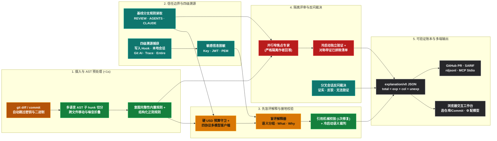
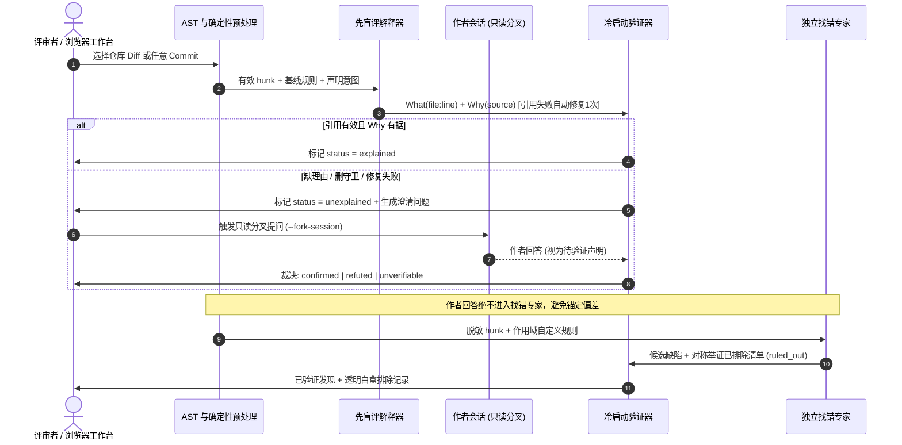
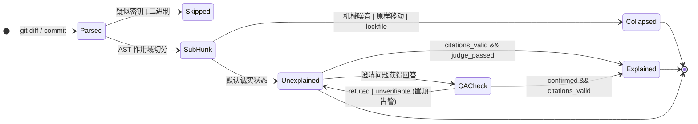

# Diffgloss

<p align="center">
  <strong>AI 编码时代的可解释性优先代码评审账本。</strong><br/>
  把任意 Git Diff 或 Commit 转化为可校验的逐 hunk 覆盖率账本、带证据的解释、对称举证评审与离线交互式浏览器导览。
</p>

<p align="center">
  <a href="https://atomsprout.com/diffgloss/"></a>
  <a href="https://github.com/atomsprout/diffgloss/releases/tag/v0.3.1"></a>
  <a href="https://github.com/atomsprout/diffgloss/actions/workflows/ci.yml"></a>
  
  
  
</p>

<p align="center">
  <strong><a href="https://atomsprout.com/diffgloss/">✦ 访问 3D 交互式官网与在线演示 ↗</a></strong>
  &nbsp;·&nbsp;
  <strong><a href="https://github.com/atomsprout/diffgloss/releases/tag/v0.3.1">⬇ 下载原生桌面应用（macOS / Windows）</a></strong>
  &nbsp;·&nbsp;
  <a href="./README.md">English</a> | <strong>简体中文</strong>
</p>

| 平台 | 原生桌面安装包（v0.3.1 · 免装 Node/Bun） |
|---|---|
| **macOS Apple Silicon (M1–M4)** | [`Diffgloss_0.3.1_aarch64.dmg`](https://github.com/atomsprout/diffgloss/releases/download/v0.3.1/Diffgloss_0.3.1_aarch64.dmg) |
| **macOS Intel (x86_64)** | [`Diffgloss_0.3.1_x64.dmg`](https://github.com/atomsprout/diffgloss/releases/download/v0.3.1/Diffgloss_0.3.1_x64.dmg) |
| **Windows x64** | [`Diffgloss_0.3.1_x64-setup.exe`](https://github.com/atomsprout/diffgloss/releases/download/v0.3.1/Diffgloss_0.3.1_x64-setup.exe) · [`Diffgloss_0.3.1_x64_en-US.msi`](https://github.com/atomsprout/diffgloss/releases/download/v0.3.1/Diffgloss_0.3.1_x64_en-US.msi) |

---

## 为什么做 Diffgloss？

AI Coding Agent 让**写代码**变得极其廉价，而**看懂大 diff** 成了真正的工程瓶颈。现有的 AI 评审工具大多只专注"找 bug"或生成未经校验的大段摘要——没有哪家能明确告诉你：**这次改动里到底还有多少块是没人能说清的。**

**gloss** 原指中世纪抄本里写在原文行间与页边的注解。Diffgloss 把代码理解做成一本**可机械核验的覆盖率账本**，每个 hunk（及 AST 切分后的语义子 hunk）都必须且只能落入以下三种状态之一：

| 状态 | 含义 | 可核验保障 |
|---|---|---|
| **`explained`** | 已被语义分组解释覆盖，且拆分为客观代码事实 `what` 与标明来源的理由 `why` | `file:line` 引用与反引号符号全部经过机械校验（`citations_valid`），可选冷启动语义裁判（`semantic_grounding`） |
| **`collapsed`** | lockfile、生成代码、纯空白/注释、纯 import 重排、纯重命名及跨文件原样移动 | 优先由确定性规则分类折叠，始终支持一键展开核对 |
| **`unexplained`** | 缺乏 `why` 证据、与声明意图背离、测试断言变弱、安全守卫被移除，或引用校验失败降级 | 置顶高亮展示，并自动生成要求代码/测试证据的澄清问题 |

---

## 系统架构



### 盲评独立性、反问隔离与对称举证时序图



### Hunk 覆盖率与溯源状态机



> **核心纪律**：反问得到的作者回答只进入解释记录的 `Why` 栏并标注来源与验证裁决，**永远不会**提供给负责找 bug 的并行专家，彻底避免作者事后辩护污染独立评审。

---

## 交互式浏览器工作台

运行 `diffgloss ui`（或离线打开生成的 `.diffgloss/report.html`）：

- **原生桌面 App（`desktop/`，Tauri v2 — macOS & Windows）**：直接把任意本机 Git 仓库文件夹拖进 `Diffgloss.app` 窗口即可秒开审查，内嵌独立编译引擎，无需额外安装 Node/Bun。
- **双角色「写码 Agent 解释 → 独立逐行审计」**：**角色 A（解释者）**支持直接对接本机 **Codex CLI** / **Claude Code CLI**（复用会话上下文与自有额度）或独立 API 模型 A；**角色 B（独立审计者）**逐行核验每一条 `+`/`-` 改动（`verified` / `omission_detected` 直接高亮漏解释行 / `contradicted` 自动降级），配合 **SSE 实时进度流** 与 **`hunk_id` 本地缓存**秒级复开。
- **仓库与提交工作台（`📂 Repo / Commit`）**：一键切换任意本机 Git 仓库、浏览最近/相邻仓库，查看 Working Tree / Staged / 分支区间，或直接点击历史中任意 Commit（自动将 Commit Message 载入 `Declared Intent`）。
- **网页内零环境变量配模型（`⚙ Models`）**：内置 **DeepSeek、Anthropic Claude、OpenAI、Google Gemini、OpenRouter、Ollama（本地免 Key）、通义 Qwen、Kimi、智谱 GLM、自定义 OpenAI 兼容端点** 10 套一键预设；配置加密权限保存至 `~/.config/diffgloss/settings.json`（`chmod 600`），支持实时 **Test Connection** 与网页内一键 **▶ Run Explain Now**。
- **高密度阅读效率**：覆盖率进度条与状态/风险/关键词筛选（`/`）、Unified / Split 双栏切换（`s`）、键盘导航（`j`/`k`/`u`）、点击 `file:line` 引用高亮对应 diff 行。
- **抗被动阅读（Self-Check 模式）**：高风险 hunk 默认遮盖 `What` 解释，点击 **Reveal What** 后揭示，防止"看着 AI 解释产生虚假理解感"。
- **全透明白盒面板**：挂载内置意图规则与外部 SARIF 发现、可展开的 **Symmetric Proof（已排除疑点与代码证明）** 以及 **规则命中遥测**。

---

## 快速上手

### 安装与构建

```bash
git clone https://github.com/atomsprout/diffgloss.git
cd diffgloss
bun install
bun run build
```

### 0. 原生桌面应用（macOS / Windows · Tauri v2）

```bash
# 编译独立 diffgloss-engine 引擎并打包原生 macOS Diffgloss.app（或 Windows 安装包）
cd desktop
bun run build:all
# -> desktop/src-tauri/target/release/bundle/macos/Diffgloss.app
# 打开后将任意本地 Git 仓库文件夹直接拖进窗口即可开始 Review！
```

### 1. 零环境变量启动浏览器工作台（推荐）

```bash
# 秒开本地浏览器工作台（http://127.0.0.1:4317）
# 点 "📂 Repo / Commit" 任选仓库或提交，点 "⚙ Models" 选模型填一次 Key 即可！
node dist/cli.js ui
```

### 2. 命令行估价与完整解释评审

```bash
# 先估算 token 与费用（不花一分钱）
node dist/cli.js explain main..HEAD --provider deepseek --dry-run

# 完整跑通：盲评解释 + 冷启动语义裁判 + 对称举证评审
DEEPSEEK_API_KEY=... node dist/cli.js explain main..HEAD \
  --provider deepseek --model deepseek-chat \
  --judge --review \
  --intent "实现滑动会话过期，不得削弱撤销态校验" \
  --serve
```

### 3. 反问裁决、SARIF 互通、CI 门禁与 MCP 服务器

```bash
# 录入并冷启动验证对未解释 hunk 的回答（支持人工或只读分叉续接 Claude/Codex 会话）
node dist/cli.js answer .diffgloss/ledger.json q1 --text "已在 src/auth/gateway.ts:88 校验" --verify

# 导入外部 CodeQL/Semgrep/ESLint SARIF 并导出全格式
node dist/cli.js inspect main..HEAD --sarif external.sarif \
  --md-out .diffgloss/report.md \
  --sarif-out .diffgloss/report.sarif \
  --rdjsonl-out .diffgloss/report.rdjsonl

# CI 覆盖率门禁（未解释数超限时返回退出码 2）
node dist/cli.js validate .diffgloss/ledger.json --max-unexplained 0

# 同步粘性覆盖率总览与指纹去重行内评论到 GitHub PR
GITHUB_TOKEN=... node dist/cli.js pr-comment --repo owner/repo --pr 42 --ledger .diffgloss/ledger.json

# 启动 MCP JSON-RPC 2.0 stdio 服务器供 Coding Agent 直接调用
node dist/cli.js mcp

# 生成 Claude Code 写入时溯源与可选 Stop 门禁钩子配置
node dist/cli.js hooks init --strict
```

---

## 黄金评测基线

内置 12 组多语言真实工程黄金评测用例（`evals/golden/cases.json`），覆盖 TypeScript、Python、Go、Rust、SQL 迁移、GitHub Actions CI、React、私钥误提交、跨文件移动、嵌套类方法夹带删守卫与 SQL 注入：

```bash
bun run typecheck   # 严格 TypeScript 类型检查（erasableSyntaxOnly）— 0 错误
bun test            # 31 项单元与集成测试（124 个断言）
node dist/cli.js eval
DEEPSEEK_API_KEY=... node dist/cli.js eval --provider deepseek --model deepseek-chat
```

| 评测集 | 模型 | 通过率 | 覆盖率不变量 | 引用有效率 | 机械误折叠数 | 总花费 |
|---|---|---:|---:|---:|---:|---:|
| 离线黄金集（12 场景） | `mock/mock-eval` | **12/12** | **100.0%** | **100.0%** | **0** | `$0.0000` |
| 真实模型黄金集（12 场景） | `deepseek/deepseek-chat` | **12/12** | **100.0%** | **100.0%** | **0** | **`$0.0078`** |

---

## 许可证

Apache-2.0 — 详见 [LICENSE](LICENSE)。
